# omp-deck

여러 개의 [omp](https://github.com/can1357/oh-my-pi) 코딩 에이전트 세션을 **브라우저와 폰에서 한눈에 보고 조작하는 대시보드**입니다.
서버의 tmux에서 돌아가는 세션들을 카드로 모아 보여 주고, 새 세션 시작·접속·모델/계정 변경·파일 보기·플랜 승인·알림을 웹에서 처리합니다.
세션 화면 공유(collab)용 릴레이도 직접 운영하므로 외부 서비스 없이 포트 하나로 동작합니다.

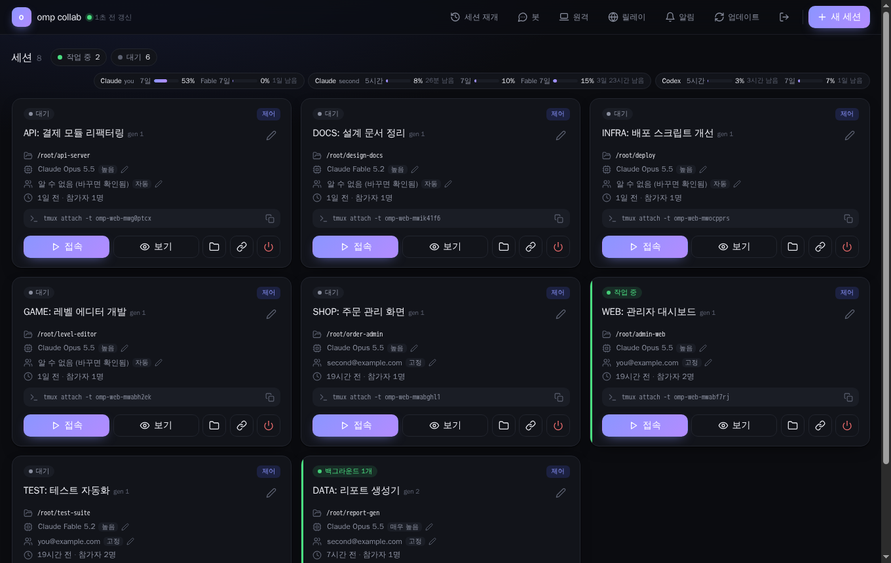

## 주요 기능

### 세션 대시보드
- 실행 중인 세션을 카드로 표시: 상태(작업 중 / 대기 / 입력 필요 / 백그라운드 작업), 폴더, 모델·생각 수준, 사용 계정, 시작 시각, 참가자 수
- 카드에서 바로 **접속**(제어) · **보기**(읽기 전용) · 파일 · 링크 복사 · 종료, 제목 바꾸기
- 상단에 작업 중/대기 요약과 **AI 사용량**(계정별 한도 %와 초기화까지 남은 시간)
- 다크·라이트 테마, 휴대폰 화면 대응(홈 화면에 추가해 앱처럼 사용)

| 라이트 테마 | 휴대폰 |
|---|---|
| 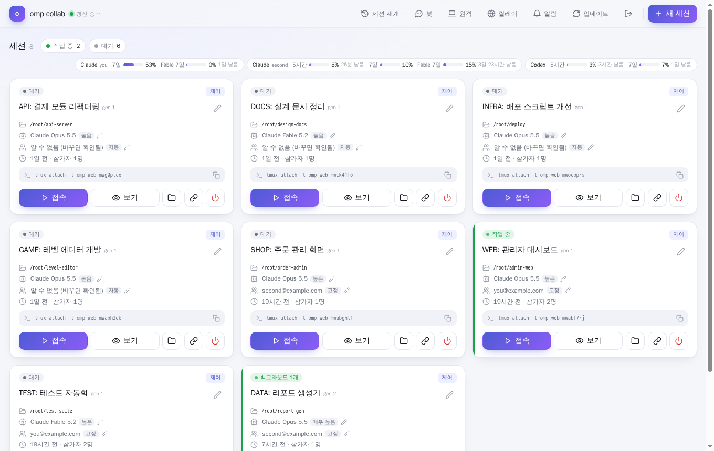 | 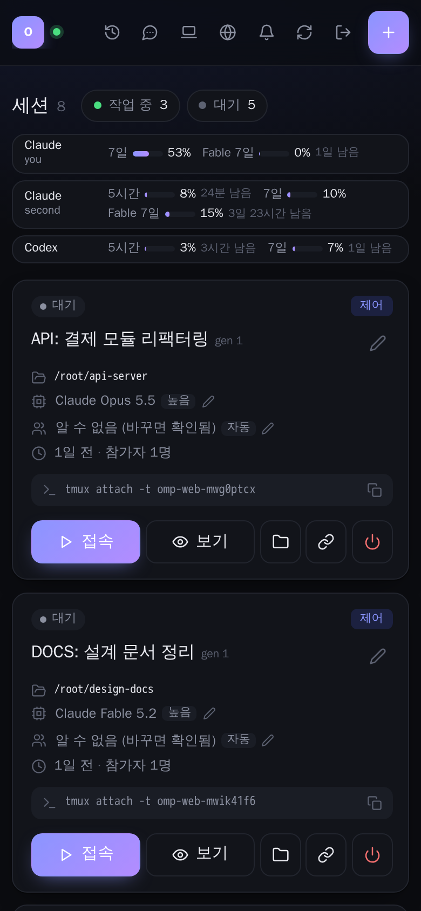 |

### 새 세션 만들기
- 실행할 컴퓨터(이 서버 / 연결된 Mac), 작업 폴더(**폴더 탐색기**로 고르기), 모델, 생각 수준, Claude 계정, 첫 지시를 정해 시작
- 없는 폴더는 확인 후 새로 만들고, 폴더별로 마지막에 고른 계정을 기억

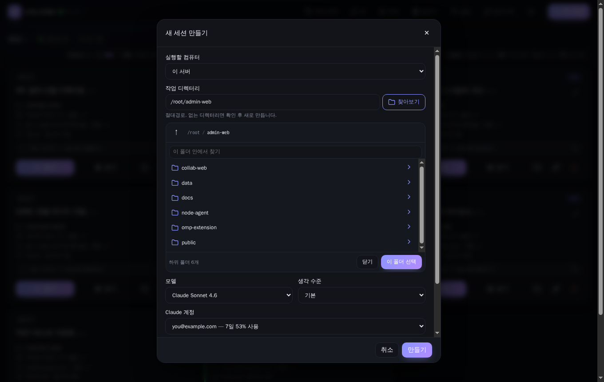

### 모델 · 계정 바꾸기
- 실행 중인 세션의 모델·생각 수준·계정을 **대화를 이어 가면서** 변경
- 계정을 여러 개 로그인해 두고 프로젝트·세션마다 다른 계정을 고정(한도에 걸리면 omp가 잠시 다른 계정으로 넘김)

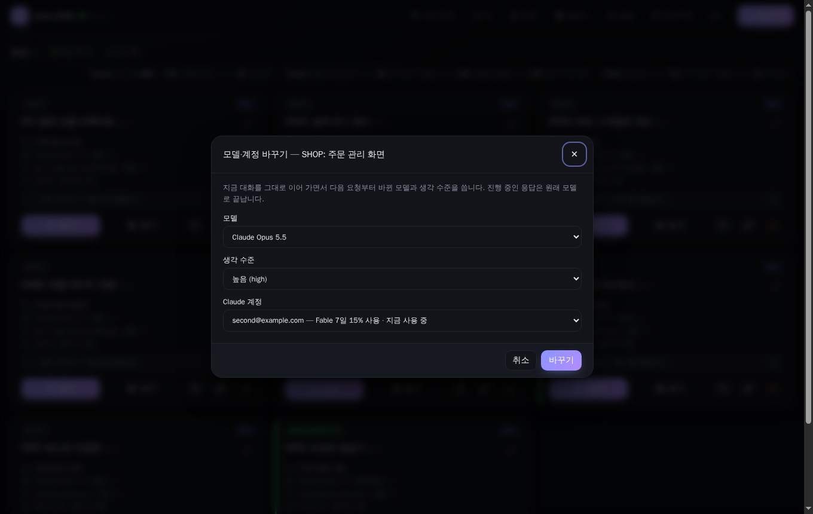

### 파일 보기
- 세션이 만든 파일(플랜 등)과 프로젝트 파일을 한곳에서: 검색, 전체/최근 변경/문서/이미지 필터
- 마크다운은 서식대로(상대 경로 이미지·링크 포함), 코드는 원문으로, 이미지는 갤러리(이전/다음, 키보드 ←/→)

| 문서 | 이미지 |
|---|---|
| 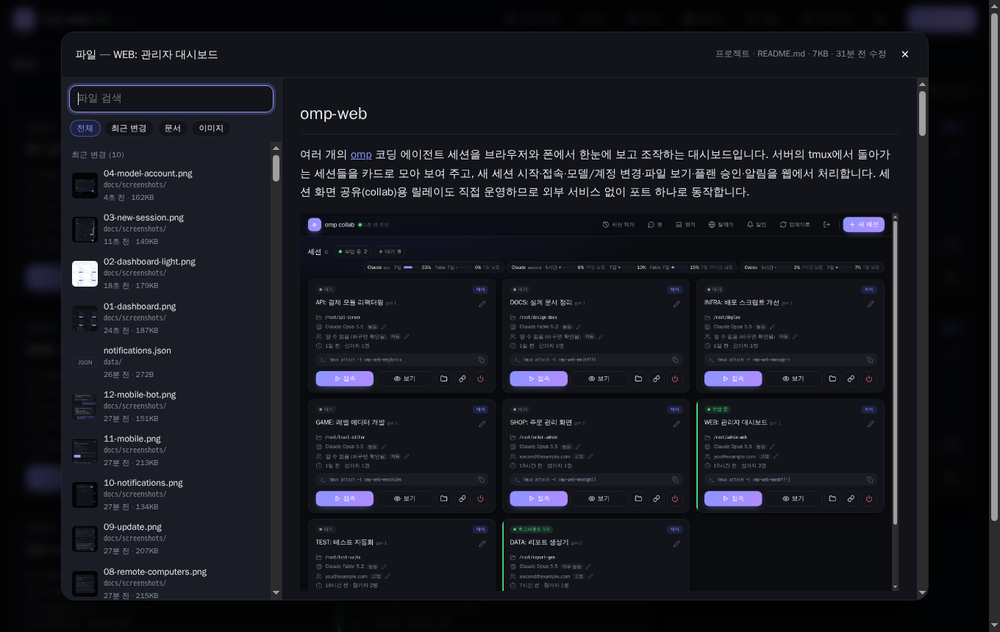 | 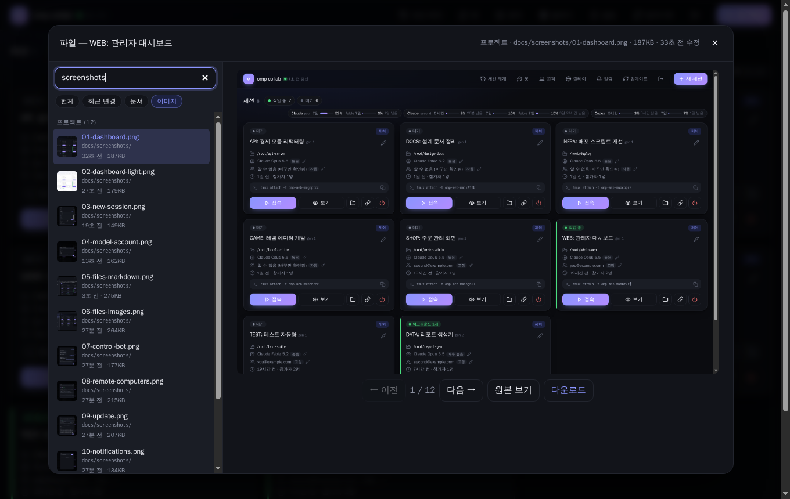 |

### 제어 봇 (대시보드 채팅 + 텔레그램)
- 대시보드를 **말로 조작**하는 AI 봇: "세션 상태 알려줘", "쇼핑 세션 뭐 하고 있는지 요약해줘", "이 세션 계정 바꿔줘", "새 세션 만들고 테스트 돌려 달라고 해"
- 세션 목록·대화 읽기·지시 보내기·만들기·모델/계정 변경·재시작·종료·플랜 승인, 사용량·알림 확인, Mac에 화면 작업 맡기기
- 텔레그램 봇과 연결하면 같은 대화를 폰에서 이어 가고, 작업 알림도 텔레그램으로 받음

| 대시보드 채팅 | 휴대폰 |
|---|---|
| 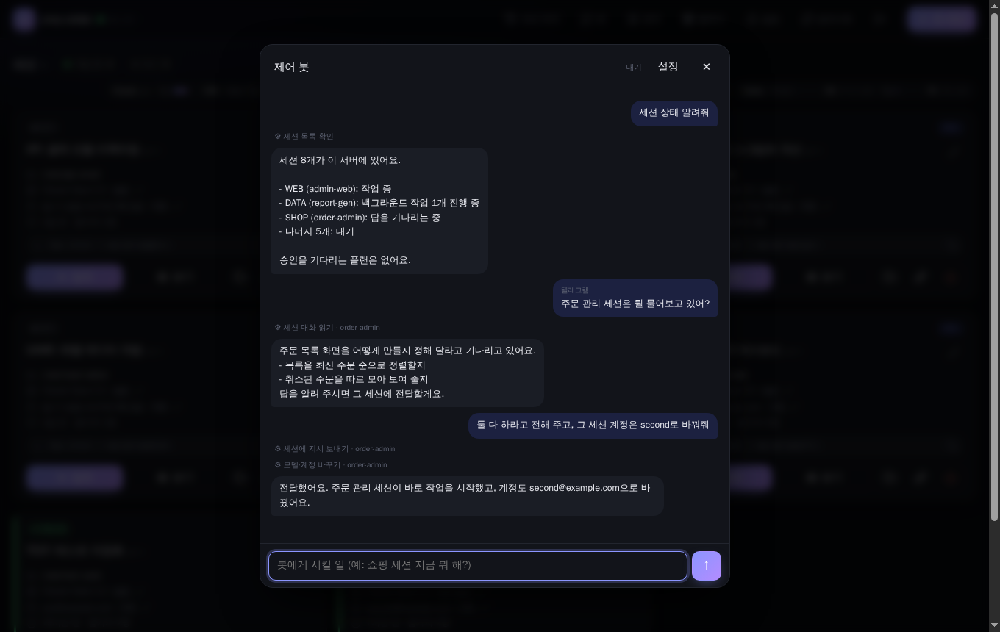 | 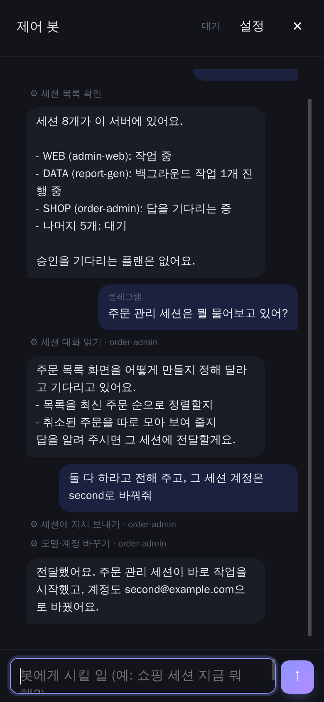 |

### 알림
- **작업 완료**(서브에이전트까지 모두 끝났을 때 한 번), **입력 필요**, **플랜 승인 필요**를 웹 푸시로(iPhone은 홈 화면 앱)
- 알림 목록에서 누르면 해당 세션이나 플랜 검토 화면으로 바로 이동

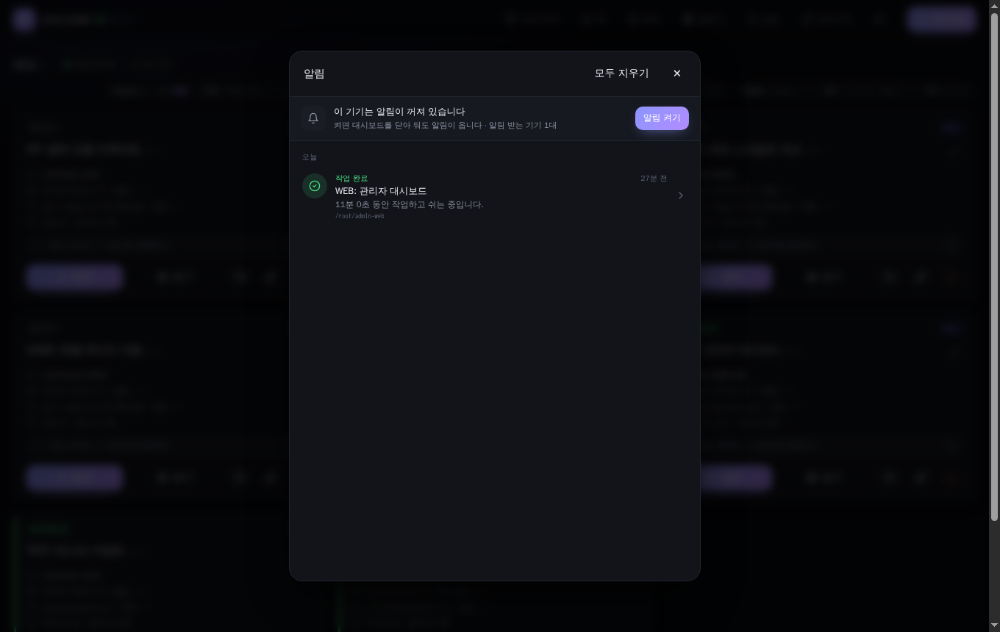

### 플랜 승인
- omp가 플랜 모드에서 승인을 기다리면 카드에 표시되고, 웹에서 플랜을 읽고 승인·수정 요청·저장

### 원격 컴퓨터 (Mac 화면 조작)
- Mac에 설치 명령 한 줄로 연결 프로그램을 설치하면, 그 Mac의 세션이 대시보드에 함께 나오고 폰에서 Mac에 세션을 시작
- AI가 Mac 화면을 보고 클릭·입력(omp 컴퓨터 제어), 서버 세션에서도 `remote_computer` 도구로 Mac에 일을 맡김
- 권한 상태 표시와 요청, Mac의 omp 버전을 서버와 자동으로 맞춤, 연결 프로그램 자동 업데이트, Mac 잠자기 방지

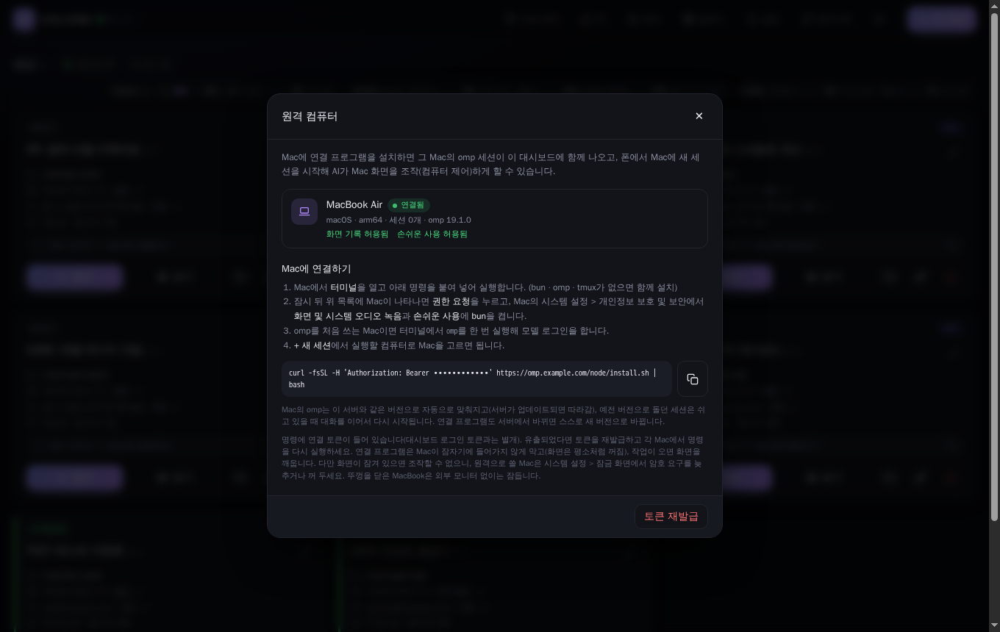

### 업데이트
- omp 업데이트와 변경 내역(한국어 번역) 확인, 예전 버전으로 돌던 세션은 **쉬고 있을 때**(서브에이전트 포함) 대화를 이어 자동 재시작

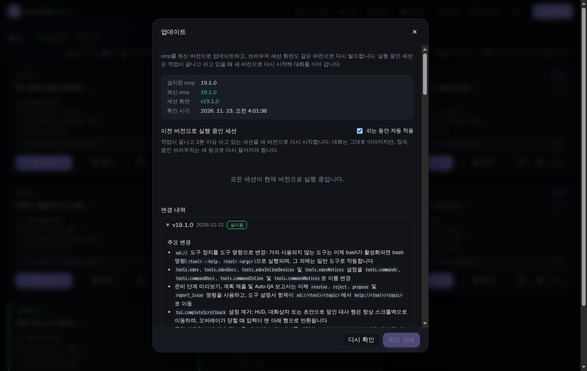

### 그 밖에
- 세션 재개: 저장된 지난 대화를 골라 다시 시작
- 자체 collab 릴레이와 웹 접속 화면(`/join`), Let's Encrypt 인증서 발급(Cloudflare DNS) 또는 리버스 프록시 뒤에서 동작
- 프로젝트용 omp 스킬(예: 게임 개발 스킬 모음)을 서버 전체에 설치해 사용

## 구조

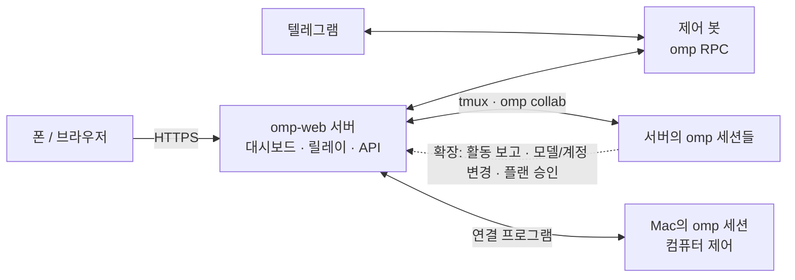

- 서버: Bun 하나로 동작(`server.ts`), npm 의존성 없음, 포트 하나(기본 7470)
- 세션 쪽 omp 확장(`omp-extension/`): 백그라운드 작업 보고, 모델·생각 수준·계정 변경, 메시지 전달, 플랜 승인 중계, 원격 컴퓨터 도구
- Mac 연결 프로그램(`node-agent/agent.ts`): launchd로 상주, 대시보드와 2초마다 동기화

## 설치와 실행

필요한 것: Linux 서버, [Bun](https://bun.sh), [omp](https://github.com/can1357/oh-my-pi)(모델 로그인까지 마친 상태), tmux.

```bash
git clone https://github.com/ez2k/omp-deck.git ~/omp-deck
cd ~/omp-deck
OMP_WEB_TOKEN=<로그인 토큰> bun run server.ts
```

브라우저에서 `http://<서버>:7470/?token=<로그인 토큰>`으로 들어가면 됩니다. 알림(웹 푸시)과 폰 홈 화면 앱은 HTTPS 주소가 필요합니다. 리버스 프록시를 두거나, 대시보드의 **릴레이** 창에서 Let's Encrypt 인증서를 발급받으세요.

처음 실행하면 세션 화면(브라우저에서 세션에 접속하는 화면)이 아직 없습니다. 대시보드의 **업데이트** 창에서 **세션 화면 다시 빌드**를 한 번 눌러 주세요. 설치된 omp 버전에 맞춰 빌드하며 git이 필요합니다.

세션 쪽 기능(백그라운드 작업 표시, 모델·계정 변경, 플랜 승인, 원격 컴퓨터 도구)은 omp 확장으로 동작합니다. `~/.omp/agent/config.yml`에 절대 경로로 등록하세요.

```yaml
extensions:
  - /root/omp-deck/omp-extension/activity.ts
  - /root/omp-deck/omp-extension/plan-review.ts
  - /root/omp-deck/omp-extension/remote-computer.ts
```

| 환경 변수 | 기본값 | 뜻 |
|---|---|---|
| `OMP_WEB_TOKEN` | 실행할 때마다 새로 생성 | 대시보드 로그인 토큰 |
| `PORT` / `HOST` | `7470` / `0.0.0.0` | 대시보드·릴레이 포트 |
| `OMP_WEB_DIRS_ROOT` | 홈 폴더 | 새 세션 폴더 탐색기의 최상위 폴더 |
| `OMP_BIN` | PATH의 `omp` | 사용할 omp 실행 파일 |

계속 띄워 두려면 `omp-web.service`의 경로를 설치 위치에 맞게 고쳐 systemd에 등록합니다. 토큰과 포트는 `data/env`에 둡니다.

```bash
printf 'OMP_WEB_TOKEN=<로그인 토큰>\nPORT=7470\n' > data/env && chmod 600 data/env
sudo cp omp-web.service /etc/systemd/system/ && sudo systemctl enable --now omp-web
```

설정, 토큰, 알림 기록, 봇 대화 같은 실행 데이터는 모두 `data/`에 저장되고 저장소에는 올라가지 않습니다.

| 파일 | 역할 |
|---|---|
| `server.ts` | 대시보드 서버, API, 세션 관리, 알림, 계정·모델 |
| `relay.ts` | collab 릴레이와 웹 접속 화면 |
| `bot.ts` | 제어 봇(omp RPC)과 텔레그램 연결 |
| `nodes.ts`, `node-agent/agent.ts` | 원격 컴퓨터 연결(서버 쪽 / Mac 쪽) |
| `push.ts` | 웹 푸시(VAPID) |
| `update.ts` | omp 업데이트, 변경 내역 번역, 접속 화면 빌드 |
| `acme.ts` | Let's Encrypt 인증서 |
| `omp-extension/` | 세션·봇에 넣는 omp 확장 |
| `public/` | 대시보드 화면(단일 HTML), 서비스 워커 |

## 보안
- 대시보드는 로그인 토큰(쿠키)으로, 세션 확장·봇 도구는 루프백 전용 내부 토큰으로, Mac 연결은 별도 토큰으로 인증합니다.
- 파일 보기는 세션의 작업 폴더와 세션 폴더 안만 열고, 원본 파일은 스크립트가 실행되지 않도록 격리해 보냅니다.
- 대시보드에 로그인할 수 있으면 세션을 조작할 수 있으므로 로그인 토큰은 비밀로 관리하세요.
